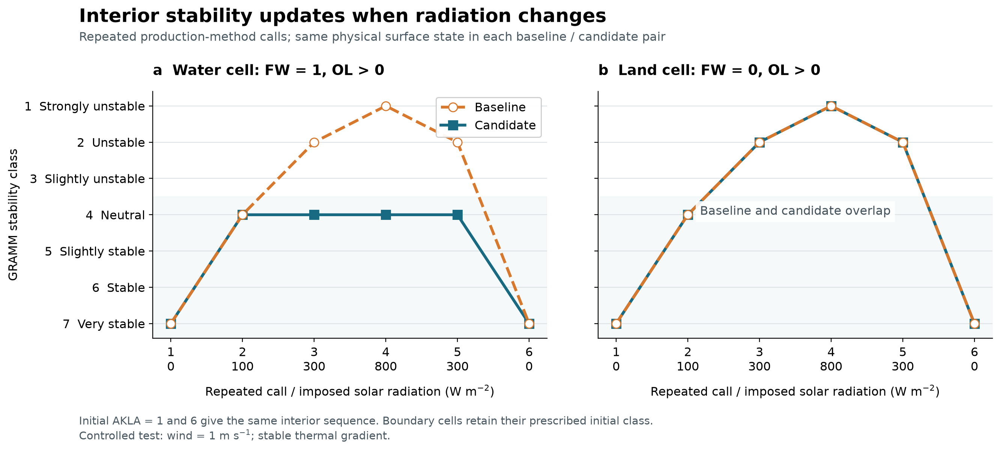
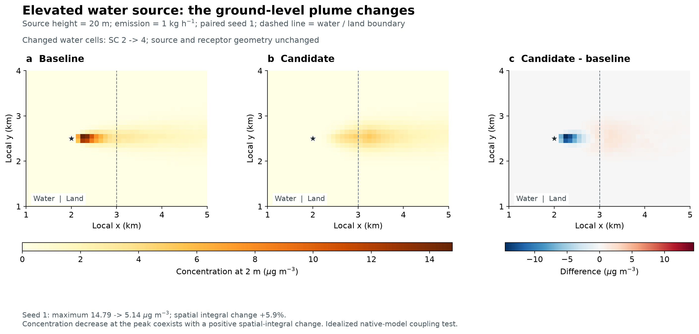

V2701 calculates Obukhov length (`OL`) from the air-surface virtual-potential-temperature scale, then assigns a stability class from a separate radiation/wind table in [PRANDTL.cs](https://github.com/GralDispersionModel/GRAMM/blob/a6fc7a3fd4d48ee057706daef09539caccfaf9bd/src/PRANDTL.cs). In sunny conditions over cool water, that table can assign convective classes 1-3 while the current `OL` is positive. GRAL then uses the imported class to [recalculate its Obukhov length and friction velocity](https://github.com/GralDispersionModel/GRAL/blob/cd540abf4eda380e5669a891911323351d789e86/src/Input_pgt.cs), so the conflicting diagnosis can change particle dispersion.

This bug fix adds six lines after the existing table. Interior water cells (`FW > 0.99`) with positive `OL` and class 1-3 receive neutral class 4. This uses the model's existing water marker and buoyancy calculation to prevent a convective classification when `OL` indicates stable or near-neutral conditions. The positive branch also includes the model's neutral limit, which is capped at `OL = 1000 m`. Class 4 is a neutral floor; selecting stable classes 5-7 would require a separate classification rule.

The class is evaluated again on each call. In a repeated-call test with radiation changing from 0 to 800 and back to 0 W/m², the representative positive-OL water cell changed from `7 → 4 → 2 → 1 → 2 → 7` before the patch to `7 → 4 → 4 → 4 → 4 → 7` after it. Land and negative-OL water retain the existing rules.

### Effect in GRAL

I tested the classification change with an unmodified GRAL V2701 build. Each pair used the same GRAMM wind, friction-velocity and OL payloads; only the stability-class payload changed. Fresh run directories avoided cached flow fields. GRAL imported class 2 → 4 in 198 water cells and recalculated their OL from −4 to +1000 m. At one source-area cell, friction velocity changed from 0.06204 to 0.05596 m/s.

The main case used a 4 × 3 km domain, 100 m cells, four 1 kg/h point sources, 1,000 particles/s and three deterministic seed realizations. At 2 m above ground, the response depended on release height:

| Water-source height | Change in maximum concentration | Change in spatial concentration integral |
| --- | ---: | ---: |
| 2 m | +9.7% to +10.9% | +156.2% to +158.8% |
| 20 m | −67.6% to −65.3% | +5.7% to +7.4% |

The integral is the sum of concentration × horizontal cell area at the 2 m sampling level. The plume map below shows why the maximum and integral can move in different directions: the ground-level peak from the elevated source shifts farther downwind after the classification changes.

Runs at 50 m resolution and 100 particles/s also responded to the class change. Warm-water, strong-wind neutral and all-land controls each preserved all 12 concentration fields exactly. Repeating the main baseline preserved all 36 fields exactly. The main paired runs took 30.7 and 44.7 seconds; the candidate run took longer in this case. These tests establish the effect on dispersion; observational accuracy requires separate evaluation.

### Validation

- Both engines build with warnings treated as errors: zero warnings and errors.
- Production-method tests: 99,792 cell executions, 199,584 class-oracle checks and 63 bitwise comparisons of physical arrays. A further 504 repeated calls covered changing radiation, wind and temperature gradient, with 140,988 checks passing.
- Native GRAMM tests: 138 executions across two grids and requested `Max_Proc` settings of 1, 2 and 8. All expected class changes and friction-velocity/OL checks passed. A fresh matrix had small wind differences in 3 of 14 pairs; targeted repeats also found them within the unchanged baseline. The maximum difference was 0.01 m/s, one saved-output increment. The final public-package reproduction added 34 runs, with one of 14 pairs differing by the same 0.01 m/s increment. The strict wind-identity result remains `review_required` in the evidence.
- GRAL linkage: 26 unmodified-engine executions plus four separate import diagnostics across the original and public-package runs. All 192 concentration payloads in the six-case matrix matched the fresh reproduction exactly. Completion, particle counts, finite/nonnegative concentrations, input hashes and output hashes were checked.

[Reproduction instructions and results](../README.md) include the full matrices, wind-repeatability findings and the three-realization concentration plot. The production diff is limited to `src/PRANDTL.cs`; test tools and figures are kept in the linked evidence branch.

### Contribution checklist

- [x] Bug fix
- [x] AI-assisted implementation and review
- [x] Local build with warnings treated as errors; no new nullable warnings
- [x] Every changed line checked against the existing calculation and water criterion; no new API introduced
- [x] Updated code comment and documented validation
