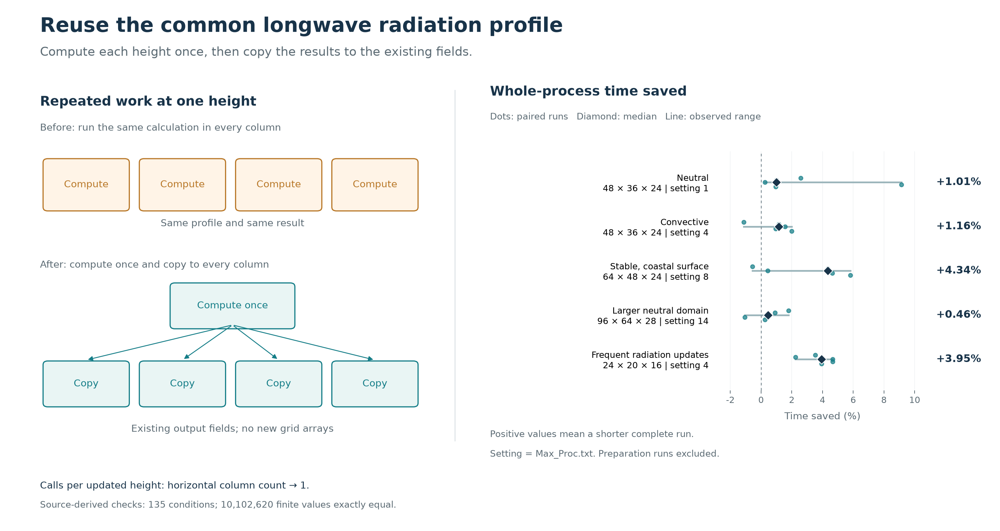

# GRAMM follow-up validation

The radiation change computes the four atmospheric emissivity terms once per vertical layer, then copies them to the horizontal columns. The original loop recalculates these terms at every column even though it reads the same reference profile. The patch changes one file and adds no array or persistent cache.

A second candidate skips momentum source values that the half-cell solver never reads. Its numerical checks passed, but the whole-model timings showed mixed results, including slower coastal and larger-grid runs. That candidate is retained here for comparison and is not being submitted.

The temperature/humidity reciprocal-pivot patch and its combination with the radiation change are included for integration checks. `source_lock.json` records every source revision, patch hash and restored source-file hash. The combined variant contains the scalar and radiation patches.

## Measured benefit

Each condition has five measured baseline/candidate pairs after one warm-up per build. The table gives the median of the paired percentage reductions in full process lifetime. All measurements, including slower runs and warm-ups, are retained in [results/native/results.json](results/native/results.json).

| Condition | Grid | Worker setting | Radiation time saved | Unused momentum sources |
|---|---|---:|---:|---:|
| Neutral | 48 × 36 × 24 | 1 | 1.01% | 0.80% |
| Convective | 48 × 36 × 24 | 4 | 1.16% | 1.54% |
| Stable coastal surface | 64 × 48 × 24 | 8 | 4.34% | -1.71% |
| Larger neutral domain | 96 × 64 × 28 | 14 | 0.46% | -0.93% |
| Frequent radiation updates | 24 × 20 × 16 | 4 | 3.95% | 0.91% |

The radiation candidate was faster in 22 of 25 pairs; the momentum candidate was faster in 12 of 25. Worker settings are the values in `Max_Proc.txt`. Native timings use uninstrumented engine builds in a hidden Windows console and include startup, integration and output. [The summary](results/native/summary.json) contains every paired percentage.

## Numerical checks

The radiation check extracts the actual loop and numerical methods from each source revision. All 135 conditions passed, with 10,102,620 finite values equal bit for bit. The momentum check calls the actual source prepass and all eight solver sweeps. Its 720 conditions cover five grids, worker settings 1/4/8, both pressure modes, the disabled momentum path, changing coefficients, terrain projections and unused entries filled with NaN or a finite sentinel.

Full-model checks use synthetic inputs and compare U, V, W, temperature, humidity, pressure, turbulence and radiation fields before output quantization. A fixed-order test adapter makes the exact comparison repeatable. Across eight conditions and five variants, all 40 processes completed, covering 50 weather situations and 360 bitwise-equal field pairs. The separate native parallel check ran 27 processes at worker settings 1, 4 and 8. Surface outputs, integration steps and steady-state diagnostics matched in every comparison. Each wind file differed in at most 3 of 124,416 components by one 0.01 m/s storage increment, including comparisons between repeated baseline runs. These adapters are kept outside the source patches.

- [Radiation method results](results/radiation_column/component_result.json)
- [Momentum method results](results/uvw_sources/component_results.json)
- [Full-model fidelity results](results/fidelity/results.json)
- [Independent completed-run validation](results/test_review/completed_validation_with_combined.json)
- [Native parallel output review](results/parallel_state/output_review.json)
- [Independent code and evidence review](results/new_code_review.md)



The [updated scalar figure](figures/scalar_review.png) uses the earlier public measurements. Its input file retains the source URLs and hashes.

## Earlier 19.6% result

The earlier local package reduced measured integration time from 0.2420425 to 0.1946000 seconds per step in a 248 × 119 × 28 coastal case, with two processes running concurrently. That measurement covered the complete optimization bundle. It does not isolate the benefit of either patch reviewed here. The largest section change was in momentum processing, where several changes were combined and some work moved to coefficient assembly. [historical_summary.json](results/historical_summary.json) preserves the measurements and the build/GC context without the research inputs.

## Reproduce

Use Python 3.10 or later, Git and the .NET 10 SDK. Native console timing requires Windows. Choose a new empty work directory; generated model outputs stay there. Each model process has a 300-second timeout.

```text
git clone https://github.com/GralDispersionModel/GRAMM.git gramm-upstream
python prepare_sources.py --upstream-checkout gramm-upstream --work-dir gramm-recheck
python run_validation.py --work-dir gramm-recheck --mode build-native
python run_validation.py --work-dir gramm-recheck --mode build-instrumented
python run_validation.py --work-dir gramm-recheck --mode components
python run_validation.py --work-dir gramm-recheck --mode smoke
```

The restore step uses upstream commit `03224ce9d3490783c84a8aecd72642fe9df21242` and the included patches. It verifies all 205 restored source files across five variants. Builds use `TreatWarningsAsErrors=true`. On hosts with several SDK installations, pass the required executable through `--dotnet`.

For the complete synthetic field and timing checks:

```text
python run_validation.py --work-dir gramm-recheck --mode fidelity --variants radiation_column uvw_sources scalar_tdma combined
python run_validation.py --work-dir gramm-recheck --mode verify-fidelity --variants baseline radiation_column uvw_sources scalar_tdma combined
python run_validation.py --work-dir gramm-recheck --mode native
python run_validation.py --work-dir gramm-recheck --mode parallel-state
```

A fresh reconstruction passed all 13 strict builds, 855 method conditions and five short model runs, with 36 exact field comparisons. Source hashes were checked again after execution. The first smoke fixture was rejected by the geometry checker because its 12-cell Y dimension left no interior beyond the six-cell border; the final fixture uses 16 × 16 × 12 cells. [The reproduction record](results/reproduction/summary.json) gives the commands and results.

To redraw the figures, install Matplotlib and run:

```text
python figures/render_radiation_column.py --summary results/native/summary.json --component results/radiation_column/component_result.json --output redrawn-figures
python figures/render_scalar_review.py --input figures/scalar_review_input.json --output redrawn-figures
```

The input generators, source-derived method checks and post-validation scripts are under `support/`. Recorded numerical summaries are under `results/`. Engine binaries, checkpoints and raw model output fields are regenerated locally.